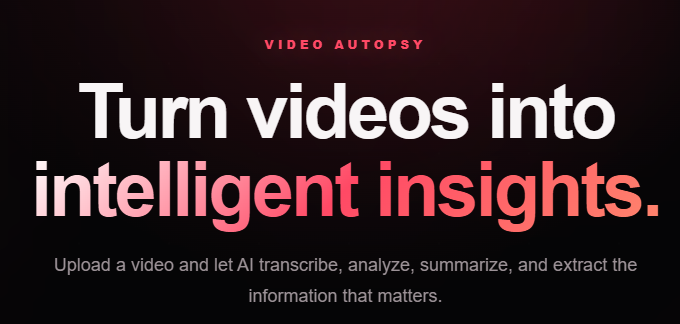
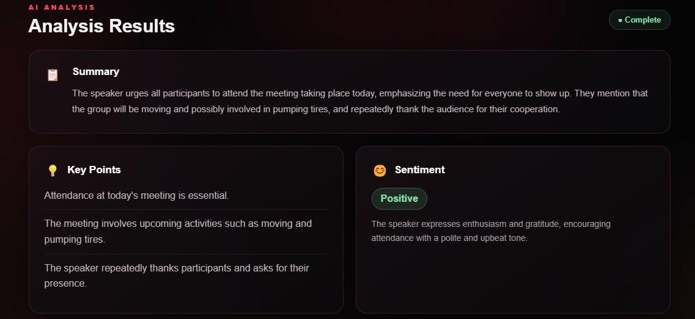
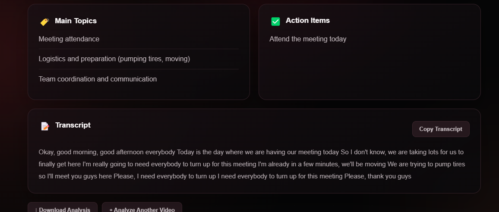

# 🎬 Video Autopsy — AI Video Analysis

**Turn videos into intelligent insights.**

Video Autopsy is an AI-powered video analysis application that extracts audio from uploaded videos, transcribes speech, and transforms the transcript into useful insights, including summaries, key points, sentiment, main topics, and action items.

## ✨ Features

* 🎥 **Video Upload:** Upload a video for analysis.
* 🎙️ **Automatic Transcription:** Convert spoken words into text using OpenAI Whisper.
* 🧠 **AI-Powered Summaries:** Generate concise summaries of video content.
* 💡 **Key Point Extraction:** Identify the most important information.
* 😊 **Sentiment Analysis:** Examine the overall sentiment of the transcript.
* 🏷️ **Topic Identification:** Discover the main subjects discussed.
* ✅ **Action Items:** Extract potential tasks and follow-up points.
* 📝 **Transcript Viewer:** Read the generated transcript.
* 📋 **Copy Transcript:** Copy the transcript to your clipboard.
* 📥 **Download Analysis:** Export the results as a text file.
* 🌙 **Dark Interface:** Use a modern, dark-themed interface.

## 🛠️ Technology Stack

| Technology     | Purpose                                     |
| -------------- | ------------------------------------------- |
| Python         | Backend development                         |
| FastAPI        | API and web server                          |
| OpenAI Whisper | Speech-to-text transcription                |
| FFmpeg         | Audio extraction from video                 |
| OpenRouter     | Access to AI models for transcript analysis |
| HTML           | Web page structure                          |
| CSS            | Styling and responsive layout               |
| JavaScript     | Frontend interactions                       |

## ⚙️ How It Works

1. Upload a video.
2. FFmpeg extracts the audio.
3. Whisper transcribes the spoken content.
4. An AI model analyzes the transcript.
5. Video Autopsy displays the summary, key points, sentiment, topics, action items, and transcript.

## 🚀 Getting Started

### Prerequisites

Before running the project, install or prepare:

* Python 3.10 or a compatible version supported by your dependencies.
* FFmpeg.
* An OpenRouter API key.
* Git (optional, for cloning the repository).

### 1. Clone the Repository

After publishing the project to GitHub, run:

```bash
git clone https://github.com/Davidsam-hub/Video-Autopsy.git
cd Video-Autopsy
```

### 2. Create a Virtual Environment

**Windows:**

```bash
python -m venv venv
venv\Scripts\activate
```

### 3. Install Dependencies

```bash
pip install -r requirements.txt
```

### 4. Configure Environment Variables

Create a `.env` file in the project root and add:

```env
OPENROUTER_API_KEY=your_openrouter_api_key
```

Replace `your_openrouter_api_key` with your own API key.

**Security:** Never commit your `.env` file or expose your API key publicly.

### 5. Configure FFmpeg

Install FFmpeg and ensure its executable is available on your system's PATH.

If FFmpeg is installed in a custom location, configure the application to use the correct executable path.

### 6. Run the Application

From the project root, execute:

```bash
uvicorn app.main:app --reload
```

Open your browser and visit:

http://127.0.0.1:8000

## 📁 Project Structure

```text
Video-Autopsy/
├── app/
│   ├── main.py
│   ├── analyzer.py
│   ├── transcription.py
│   ├── video.py
│   └── prompts.py
├── static/
│   ├── index.html
│   ├── style.css
│   └── app.js
├── uploads/
├── outputs/
├── .env
├── .gitignore
├── requirements.txt
└── README.md
```

*Note: The structure above describes the expected layout. Update it if your actual project structure differs.*

## 🔒 Security & Privacy

* Keep API keys in environment variables.
* Exclude `.env` and other sensitive files from version control.
* Avoid uploading confidential videos unless you understand how the application and its AI providers process the content.
* Review file retention and deletion behavior before deploying the application for public use.

## 🗺️ Roadmap

* [x] Video upload and preview
* [x] Audio extraction
* [x] Speech transcription
* [x] AI-generated analysis
* [x] Transcript copying and analysis download
* [ ] Improved processing progress indicators
* [ ] Public deployment
* [ ] Meeting Mode for real-time meeting notes
* [ ] Usage limits and subscription options

## 👨‍💻 Author

**David Ijomasam**

Electrical/Electronic Engineering student and Python developer interested in AI, automation, and building practical software.

GitHub: [@Davidsam-hub](https://github.com/Davidsam-hub)

## 📄 License

A license has not yet been selected for this project. Licensing information will be added when one is chosen.

## 📸 Screenshots

### Homepage


### AI Analysis Results


### Transcript
